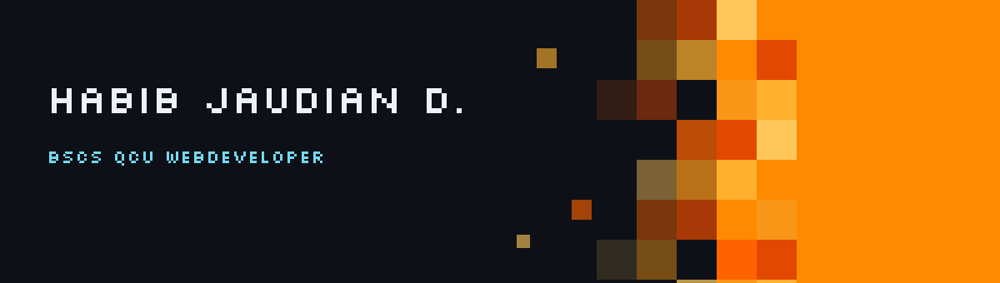
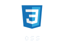
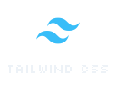
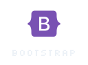
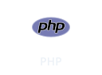
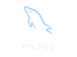
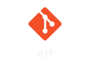
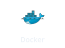
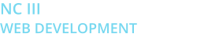
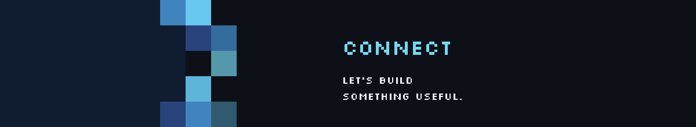

<!-- Self-contained SVG source supplies smooth lettering and abstract square geometry.
     The full profile renders here on GitHub. -->

<picture>
  <source media="(max-width: 640px)" srcset="assets/readme/profile-banner-mobile.svg">
  
</picture>

<h2>About</h2>

<h3>Building useful software, one project at a time.</h3>

<h3>I'm a BSCS student at <strong><ins>Quezon City University</ins></strong> who enjoys building web applications and exploring software engineering.</h3>

<h2>Tech Stack</h2>

  
  
  
  
  
  
  
  
  
  
  
  

<h2>Education</h2>

<h3></h3>
<h3><strong><ins>Quezon City University</ins></strong></h3>

<h3></h3>
<h3><strong><ins>TESDA</ins></strong></h3>

<h2>Connection</h2>

<picture>
  <source media="(max-width: 640px)" srcset="assets/readme/connect-banner-mobile.svg">
  
</picture>

<a href="https://www.facebook.com/habib.jaudian.1">Facebook</a> · <a href="https://www.instagram.com/tsmhabib03?igsh=MWFoaTBnOXcxZ3dqdg%3D%3D">Instagram</a> · <a href="https://github.com/TsmHabib03">GitHub</a> · <a href="mailto:jaudianhabib879@gmail.com">Email</a>

