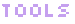
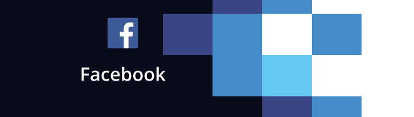
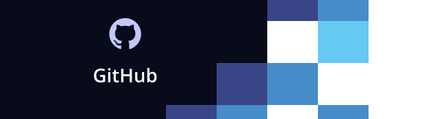

<!-- Self-contained SVG source supplies smooth lettering and abstract square geometry.
     The full profile renders here on GitHub. -->

<picture>
  <source media="(max-width: 640px)" srcset="assets/readme/profile-banner-mobile.svg">
  
</picture>

<h2>About</h2>

<strong>Building useful software, one project at a time.</strong>

I'm a BSCS student at Quezon City University who enjoys building web applications and exploring software engineering.

<h2>Tech Stack</h2>

<h3></h3>

  
  
  
  
  

<h3></h3>

  
  

<h3></h3>

  

<h3></h3>

  
  
  
  

<h2>Education</h2>

<h3></h3>

Quezon City University

<h3></h3>

TESDA

<h2>Connection</h2>

<!-- A single banner table keeps each social image independently clickable on GitHub. -->
<table width="100%" cellpadding="0" cellspacing="0">
<tr><td colspan="2">
<picture>
  <source media="(max-width: 640px)" srcset="assets/readme/connect-banner-mobile.svg">
  
</picture>
</td></tr>
<tr>
<td width="50%"><a href="https://www.facebook.com/habib.jaudian.1"><picture><source media="(max-width: 640px)" srcset="assets/readme/connect-facebook-mobile.svg"></picture></a></td>
<td width="50%"><a href="https://www.instagram.com/tsmhabib03?igsh=MWFoaTBnOXcxZ3dqdg%3D%3D"><picture><source media="(max-width: 640px)" srcset="assets/readme/connect-instagram-mobile.svg"></picture></a></td>
</tr>
<tr>
<td width="50%"><a href="https://github.com/TsmHabib03"><picture><source media="(max-width: 640px)" srcset="assets/readme/connect-github-mobile.svg"></picture></a></td>
<td width="50%"><a href="mailto:jaudianhabib879@gmail.com"><picture><source media="(max-width: 640px)" srcset="assets/readme/connect-email-mobile.svg"></picture></a></td>
</tr>
</table>
