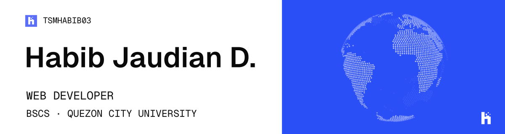
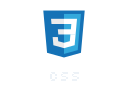
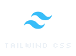
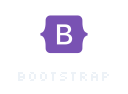
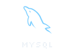
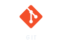
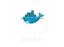
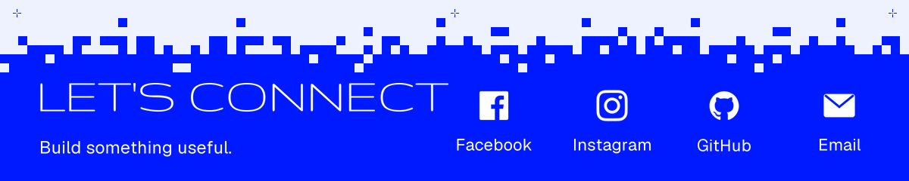

<!-- Animated geographic globe rendered from code; GIF works directly on GitHub. -->

<picture>
  <source media="(prefers-reduced-motion: reduce) and (max-width: 640px)" srcset="assets/readme/profile-globe-mobile-still.png">
  <source media="(prefers-reduced-motion: reduce)" srcset="assets/readme/profile-globe-still.png">
  <source media="(max-width: 640px)" srcset="assets/readme/profile-globe-mobile.gif">
  
</picture>

<h2>Tech Stack</h2>

  
  
  
  
  
  
  
  
  
  
  
  

<h2>Education</h2>

<h3></h3>
<h3><strong><ins>Quezon City University</ins></strong></h3>

<h3></h3>
<h3><strong><ins>TESDA</ins></strong></h3>

<h2>Connection</h2>

<picture>
  <source media="(prefers-reduced-motion: reduce) and (max-width: 640px)" srcset="assets/readme/connect-banner-mobile-still.png">
  <source media="(prefers-reduced-motion: reduce)" srcset="assets/readme/connect-banner-still.png">
  <source media="(max-width: 640px)" srcset="assets/readme/connect-banner-mobile.gif">
  
</picture>

<a href="https://www.facebook.com/habib.jaudian.1">Facebook</a> · <a href="https://www.instagram.com/tsmhabib03?igsh=MWFoaTBnOXcxZ3dqdg%3D%3D">Instagram</a> · <a href="https://github.com/TsmHabib03">GitHub</a> · <a href="mailto:jaudianhabib879@gmail.com">Email</a>

